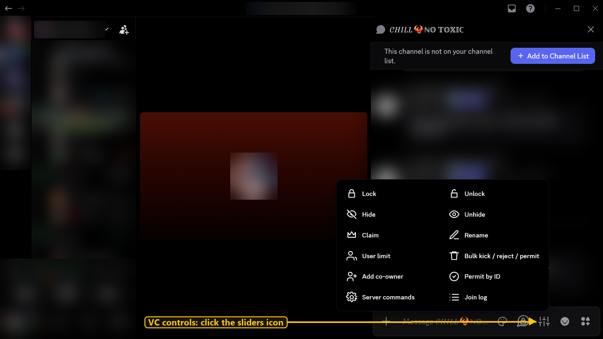
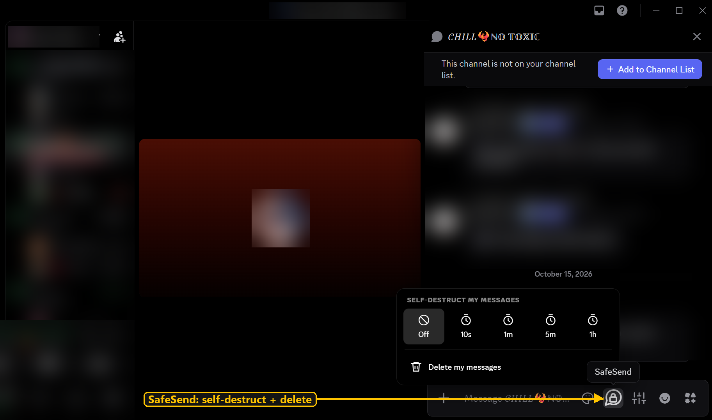
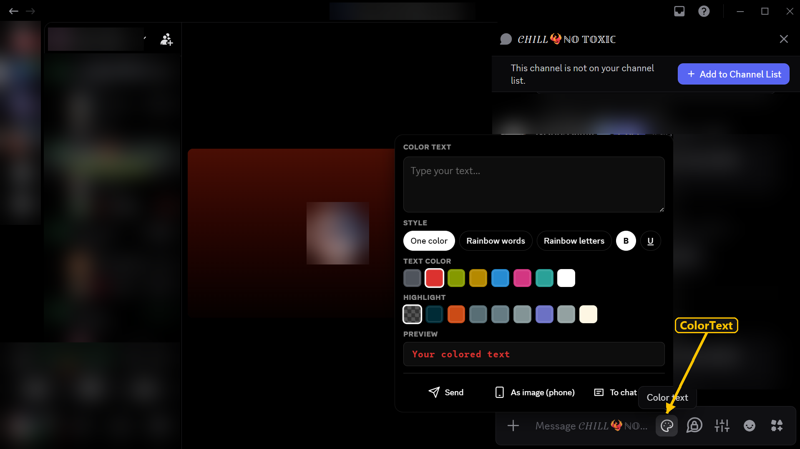

# VC Plugins for Vencord

Four Discord plugins for managing your voice channel: **VcQuickKick**, **VcTagger**, **SafeSend** and **ColorText**.

### 🔵 1 · Reject with one click
Click the red **X** on someone's card or next to their name. Right-click it for more actions.


### 🟢 2 · VC controls
The **sliders icon** in your VC chat bar: lock, hide, claim, rename, limit, bulk actions, permit, join log and more.



### 🟡 3 · SafeSend
The **lock bubble**: make your messages delete themselves, or delete all your messages in a chat.



### 🩷 4 · ColorText
The **palette icon**: colored or rainbow text, or send it as an image so phones see the colors.



---

## Install

**1.** Install [Git](https://git-scm.com/download/win) and [Node.js](https://nodejs.org) (LTS). Then open **PowerShell** and run:

```bash
npm install -g pnpm
```

**2.** Download Vencord and the plugins:

```bash
cd $HOME\Desktop
```
```bash
git clone https://github.com/Vendicated/Vencord
```
```bash
cd Vencord
```
```bash
git clone https://github.com/1devaz/vc-plugins src/userplugins/vc-plugins
```

**3.** Build and install. When the installer opens, pick your Discord and press **Install**:

```bash
pnpm install
```
```bash
pnpm build
```
```bash
pnpm inject
```

**4.** Fully quit Discord and open it again. Go to **Settings → Vencord → Plugins** and turn on the four plugins.

> **Already have Vencord?** Do the same steps. Your settings and themes are kept.

---

## Update

```bash
cd $HOME\Desktop\Vencord
```
```bash
git -C src\userplugins\vc-plugins pull
```
```bash
pnpm build
```

Then restart Discord.

## Other servers

Commands use `.v` by default. If a server's bot uses something else (like `!v`), use any command once and it's detected, or set it in **VC controls → Server commands**.

## Notes

- Source code only: no `.exe`, no hidden code, no outside connections. Only install from this page.
- Client mods are against Discord's Terms of Service. Use at your own risk.
- License: GPL-3.0-or-later, same as Vencord.
