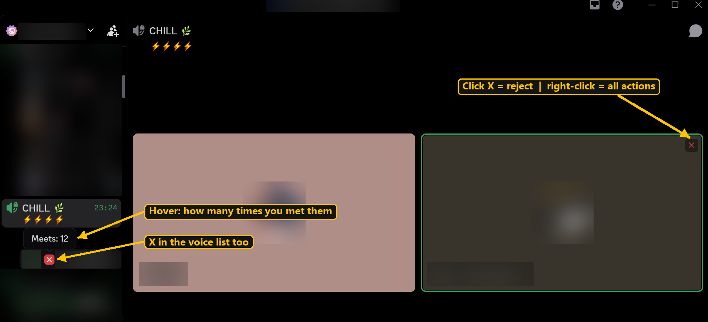
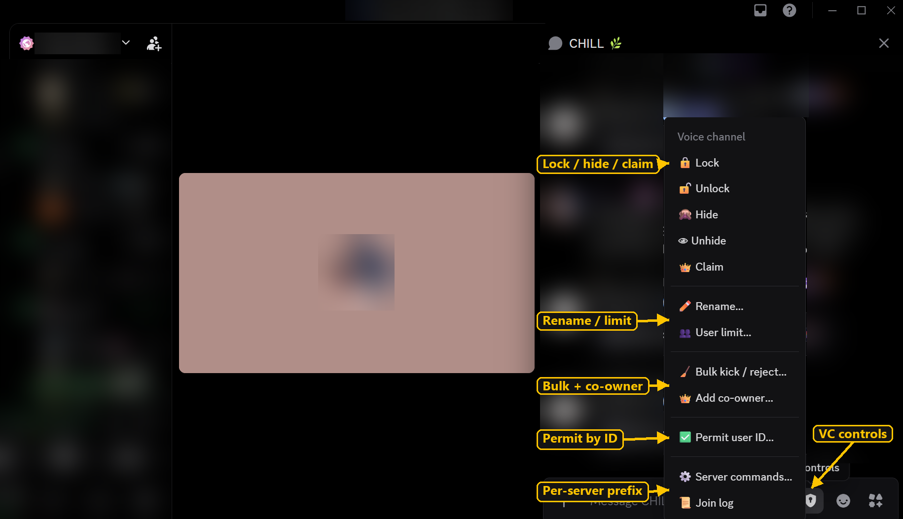

# VC Plugins for Vencord

Three plugins for Discord (through [Vencord](https://github.com/Vendicated/Vencord)) that make managing your temp voice channel easy. No more typing `.v reject 123456789…` by hand.

- **VcQuickKick**: one-click kick / reject / permit, bulk actions, co-owner and a VC control panel
- **VcTagger**: tag people (e.g. "KICKED ME") and see the tag next to their name. Tagged people get rejected automatically when they join your VC
- **SafeSend**: protect your own messages: self-destruct timer, send text as an image, edit warning, delete all your messages in a chat




---

## Contents

1. [What you can do](#what-you-can-do)
2. [Install (step by step)](#install-step-by-step)
3. [How to use](#how-to-use)
4. [Using it on other servers](#using-it-on-other-servers)
5. [Update, uninstall, problems](#update-uninstall-problems)
6. [Security](#security-what-these-plugins-can-and-cant-do)

---

## What you can do

| Feature | How |
|---|---|
| **Reject / kick someone** | Click the red **✕** next to their name in the voice list, or in the corner of their card in the call |
| **More actions** | Right-click the **✕**, or right-click the person anywhere → **VC actions**: reject, kick, text mute/unmute, permit, add co-owner, force mute/deafen |
| **Bulk reject / kick / permit** | Shield button → **🧹 Bulk kick / reject / permit…**, tick people, press a button |
| **Let someone back in** | Shield button → **✅ Permit user ID…** or **✅ Permit recently removed**. They get pinged so they know they can rejoin |
| **Lock / hide / claim / rename / limit** | Shield button in the chat bar of your VC |
| **Auto-reject people you don't want** | Tag them with VcTagger. Next time they join your VC, they're rejected automatically |
| **Join log** | Shield button → **📜 Join log**: who joined/left, with avatars and pages |
| **"Meets" counter** | Hover the **✕** to see how many times you've been in a VC with someone |

Your own command messages (`.v reject …`) are deleted automatically after 2 seconds, so the chat stays clean.

### SafeSend (🔒 lock button in every chat bar)

| Feature | How |
|---|---|
| **Self-destruct** | 🔒 → pick 10s / 1m / 5m / 1h. Every message you send deletes itself after that time. The lock turns yellow while it's on |
| **Send as image** | 🔒 → **🖼️ Send as image…**. Your text becomes a picture. Message loggers only keep a *link* to images, so once you delete it, it stops loading for them |
| **Edit warning** | Editing a message asks first, because loggers keep every edit. Choose **Delete + resend** or **Edit anyway** |
| **Delete all my messages** | 🔒 → **🗑️ Delete all my messages here**. Deletes only *yours* in that chat (VC chats too), about 1 per second. Click again to stop |
| **Delete everyone's messages** | 🔒 → **🧨 Delete ALL messages here**. Only shows if you have **Manage Messages** in that chat. Shows in the server's audit log |

> No plugin can erase what someone already saw, logged or screenshotted. SafeSend just keeps that window as small as possible.

---

## Install (step by step)

> ⏱ About 10 minutes the first time. You only do this once.
> 💻 These steps are for **Windows**. Mac/Linux work the same way in a terminal.

### Step 1: Install 3 free programs

Download and install these, clicking **Next** through each installer with the default options:

1. **Git**: https://git-scm.com/download/win
2. **Node.js**: https://nodejs.org (pick the **LTS** button)

Then open **PowerShell** (press the Windows key, type `powershell`, press Enter) and run this to install the 3rd one, **pnpm**:

```bash
npm install -g pnpm
```

> If PowerShell says `npm` is not recognized, close it, open it again and retry (it needs a restart after installing Node.js).

### Step 2: Download Vencord and the plugins

In the same PowerShell window, run these one at a time:

```bash
cd $HOME\Desktop
```
```bash
git clone https://github.com/Vendicated/Vencord
```
```bash
cd Vencord
```
```bash
git clone https://github.com/1devaz/vc-plugins src/userplugins/vc-plugins
```

This creates a **Vencord** folder on your Desktop with our plugins inside it. Keep that folder; you need it for updates.

### Step 3: Build and install

```bash
pnpm install
```
```bash
pnpm build
```
```bash
pnpm inject
```

`pnpm inject` opens a small installer: choose your Discord (usually **Stable**) and press **Install / Patch**.

> Already use the normal Vencord installer? That's fine: this replaces it with your own build, and your Vencord settings stay.

### Step 4: Turn the plugins on

1. **Fully close Discord** (right-click the Discord icon near the clock → **Quit Discord**) and open it again
2. Open **User Settings** (⚙ bottom-left) → **Vencord** → **Plugins**
3. Search **VcQuickKick**, **VcTagger** and **SafeSend** and switch each one on
4. Done 🎉 Join a VC and you'll see the **✕** buttons and the **shield** button in the chat bar

---

## How to use

**Reject someone:** click the **✕** next to their name. (Change it to *kick* instead in the plugin settings.)

**Undo a reject:** shield button → **✅ Permit recently removed** → click their name. They get a ping in the VC chat.

**Clear out lots of people:** shield button → **🧹 Bulk kick / reject / permit…**
- tick people in your VC, or people you removed earlier
- **Reject** and **Kick** send up to 3 people per command
- **Permit** sends one command per person (that's how the bot works)

**Block someone for good:** right-click them → tag them with **VcTagger**. Every time they join your VC, they're rejected automatically.
If you permit them later, they're allowed in again. If you tag them *again* after that, the auto-reject comes back.

**Settings:** *User Settings → Vencord → Plugins →* ⚙ next to **VcQuickKick**. You can change:
- what a left-click on ✕ does (reject or kick)
- auto-reject on/off
- how fast your command messages get deleted
- the delay between bulk commands
- every command's text

---

## Using it on other servers

By default the plugins use the `.v` prefix (`.v reject`, `.v lock`…). If a server's voice bot uses something else, like `!v`:

- **Easiest:** just use any VC command once in that server (e.g. `!v lock`). When the bot replies, the plugin learns the prefix and shows *"Detected !v…"*
- **Or set it yourself:** join a VC in that server → shield button → **⚙️ Server commands…** → type the prefix → **Save**

If the bot uses different *words* (e.g. `ban` instead of `reject`), change just those boxes in the same window. Each server remembers its own setup.

---

## Update, uninstall, problems

**Update to the newest version.** In PowerShell:

```bash
cd $HOME\Desktop\Vencord\src\userplugins\vc-plugins
```
```bash
git pull
```
```bash
cd $HOME\Desktop\Vencord
```
```bash
pnpm build
```

Then restart Discord (Quit from the tray icon and open it again).

**Uninstall Vencord completely:**

```bash
cd $HOME\Desktop\Vencord
```
```bash
pnpm uninject
```

**Something's wrong?**

| Problem | Fix |
|---|---|
| Plugins don't show in the list | Make sure the folder is at `Vencord\src\userplugins\vc-plugins`, run `pnpm build`, restart Discord |
| No ✕ buttons | You only see them for people in **your** VC (not your own name) |
| Nothing happens when I click ✕ | Check the prefix: shield button → **⚙️ Server commands…** |
| Discord updated and Vencord is gone | Run `pnpm inject` again |
| "You're not in a voice channel" | The commands are sent in your VC's chat, so you have to be in a VC |

---

## Security: what these plugins can and can't do

The repo is **source code only**: three small `.tsx` files and three `.css` files, no `.exe`, no `.dll`, no scripts, no minified or obfuscated code. You build it yourself with Vencord, so what you read is what runs. GitHub's CodeQL scanner also checks the code automatically (see the **Security** tab).

| | |
|---|---|
| **Network** | Only Discord's own API, through Vencord's built-in Discord client. No `fetch`, no WebSockets, no outside servers, no analytics |
| **Discord API calls** | `GET /guilds/{id}/application-command-index` (list a server's bot slash commands) · `PATCH /guilds/{id}/members/{id}` (server mute/deafen, only when you click it and Discord allows it) · `GET /users/@me/notes/{id}` (read *your own* note on a user, VcTagger) · `GET /channels/{id}/messages` and message search (SafeSend: find the messages to delete) · `DELETE` messages (SafeSend, only when you start it) |
| **Messages** | Only the VC commands you trigger (e.g. `.v reject <id>`), the permit ping, and the image / resend you choose in SafeSend |
| **Storage** | Vencord's local plugin settings + DataStore (your tags, "meets" count). Nothing leaves your PC |
| **Your computer** | No file system access, no `eval`, no dynamic imports, no native code, no `child_process` |
| **Your account** | Never reads or touches your token, password or email |

**Check it yourself** in the repo folder. Each command should find nothing:

```bash
grep -rnE "fetch\(|XMLHttpRequest|WebSocket|eval\(|new Function|import\(|require\(|child_process|VencordNative|localStorage|token" vcQuickKick vcTagger safeSend
```
```bash
grep -rnoE "https?://[^\"' ]+" vcQuickKick vcTagger safeSend
```
The second one only shows `cdn.discordapp.com` (Discord's default avatars).

> Only install from **this GitHub page**. Never run "modified versions" someone sends you as a zip or file in DMs.

## Notes

- Only you see the buttons. Everyone else just sees the normal bot commands.
- Client mods are against Discord's Terms of Service. Use at your own risk.

## License

GPL-3.0-or-later, same as Vencord.
